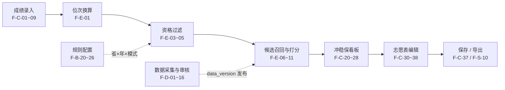

# 功能清单

> AdmitAtlas · 全国高校录取数据档案库与高考志愿匹配平台
> 本文回答「**具体要做哪些功能**」；架构怎么设计看 [架构设计](架构设计.md)，什么时候做看 [路线图](路线图.md)，接口怎么调看 [接口说明](接口说明.md)。

---

## 〇、阅读约定

**编号规则**

| 前缀 | 域 | 说明 |
|---|---|---|
| `F-C-xx` | C 端 | 学生 / 家长使用的前台功能 |
| `F-B-xx` | B 端 | 运营、数据管理员使用的后台功能 |
| `F-D-xx` | 数据侧 | 离线采集与数据治理（不挂 C 端入口） |
| `F-E-xx` | 引擎侧 | 匹配引擎内部能力，多数不直接暴露 UI |
| `F-S-xx` | 平台侧 | 认证、审计、监控、导出等横切能力 |

**优先级**：`P0` 骨架已交付 · `P1` 单省试点必须 · `P2` 全国规则与数据流水线必须 · `P3` 提质与规模化。
**状态**：`已实现`（P0 骨架可运行）· `占位`（页面或接口存在但返回占位值）· `待开发`（P1 及以后）。

**功能主链路**

**全局约束（所有功能默认遵守）**

1. 跨年比较一律用**位次**，分数只用于展示与录入。
2. 志愿结构由「省 × 年 × 考试模式」规则驱动，禁止在前端或引擎里硬编码 45 / 96 / 112。
3. 输出**匹配度 / 风险等级**，不输出「录取率」「保录取」等概率承诺。
4. 所有录取数据必须带 `source_url` 与 `data_version`，页面统一标注「以各省教育考试院公布为准」。
5. 单科分数按**规则条件**建模（同分排序、专业单科门槛），不作为录取结果的公开数据列。

---

## 一、功能总览

| 域 | 功能组 | 条数 | 主优先级 | 主模块 |
|---|---|---|---|---|
| C 端 | 成绩档案、院校专业库、分数线查询、智能匹配、志愿方案、政策辅助 | 48 | P1 | `auth-user` `school` `score` `match-engine` `plan-report` |
| B 端 | 数据审核、档案维护、规则配置、版本发布、运营支撑 | 26 | P2 | `data-collector` `policy-rule` `school` |
| 数据侧 | 数据源登记、采集调度、解析标准化、质量校验与入库 | 16 | P2 | `data-collector` |
| 引擎侧 | 位次换算、资格过滤、召回打分、分档解释、性能 | 15 | P1 | `match-engine` |
| 平台侧 | 认证权限、审计、导出、监控、数据版本一致性 | 16 | P1~P3 | `common-core` `gateway` `launcher` |

合计 **121 个功能点**。其中 P0 骨架已实现 7 个、占位 8 个，其余 106 个按 P1~P3 排期。

---

## 二、C 端功能（学生 / 家长）

### 2.1 成绩档案与位次换算 `F-C-01 ~ 09`

| 编号 | 功能点 | 具体说明 | 优先级 | 模块 | 状态 |
|---|---|---|---|---|---|
| F-C-01 | 分步成绩向导 | 省份 → 年份 → 考试模式 → 科类/选科 → 总分 → 单科分 六步；上一步变更时自动清空并校验下游选项 | P1 | `auth-user` | 占位 |
| F-C-02 | 省份-模式联动 | 选择省份后仅显示该省当年启用的考试模式（传统文理 / 院校专业组 / 专业+院校），不显示无效组合 | P1 | `policy-rule` | 待开发 |
| F-C-03 | 选科组合校验 | 3+1+2 模式校验首选科目（物理/历史二选一）、再选科目不重复；3+3 模式校验科目数；传统模式只选文/理 | P1 | `policy-rule` | 待开发 |
| F-C-04 | 总分与单科录入 | 总分按省满分校验（如 750）；单科分逐项录入并做区间校验；缺项时允许跳过但标记「不完整」 | P1 | `auth-user` | 占位 |
| F-C-05 | 自动位次换算 | 用当年一分一段表把总分转为省排名（含同分人数区间），返回 `rank` / `rankRange` / `isEstimated` | P1 | `score` | 待开发 |
| F-C-06 | 位次估算降级 | 当年一分一段未发布时，用最近年份同比例估算并明确标注「估算值，仅供预览」 | P2 | `score` | 待开发 |
| F-C-07 | 限制条件录入 | 语种、体检结论、单科门槛、是否服从调剂、加分资格等；作为后续资格过滤的输入 | P1 | `auth-user` | 待开发 |
| F-C-08 | 多份成绩档案 | 支持保存模考 / 正式成绩多份档案，可切换、复制、删除，匹配时指定使用哪一份 | P2 | `auth-user` | 待开发 |
| F-C-09 | 成绩有效性提示 | 总分低于当年批次线、选科与模式不匹配、位次缺数据时给出可理解的提示而非直接报错 | P1 | `auth-user` | 待开发 |

### 2.2 院校与专业库 `F-C-10 ~ 19`

| 编号 | 功能点 | 具体说明 | 优先级 | 模块 | 状态 |
|---|---|---|---|---|---|
| F-C-10 | 院校检索 | 关键词（校名/代码）+ 层次（985/211/双一流/省重点）+ 地域 + 类型（综合/理工/师范…）+ 办学性质 + 批次 多条件筛选与分页 | P1 | `school` | 占位 |
| F-C-11 | 院校档案详情 | 基本信息、主管部门、所在地、学科评估、硕博点、招生章程链接、联系方式、官方来源标注 | P1 | `school` | 待开发 |
| F-C-12 | 院校历年录取 | 该校在本省近 3~5 年投档线 / 最低位次 / 计划数表格 + ECharts 趋势图，分数与位次双轴可切换 | P1 | `score` | 待开发 |
| F-C-13 | 院校专业组查询 | 按「省 + 年 + 科类」列出该校全部专业组、组内专业、选科要求、计划数 | P2 | `school` | 待开发 |
| F-C-14 | 专业目录树 | 学科门类 → 专业类 → 专业 三级导航，展示专业代码、修业年限、学位、选科要求 | P1 | `school` | 待开发 |
| F-C-15 | 专业开设院校 | 从专业反查开设院校列表，并标注「本省是否招生 / 今年是否有计划」 | P2 | `school` | 待开发 |
| F-C-16 | 选科要求速查 | 输入本人选科组合，标记每个专业/专业组「可报 / 不可报 / 需确认」，物化绑定等规则来自配置 | P2 | `policy-rule` | 待开发 |
| F-C-17 | 招生计划查询 | 按省/年/院校/专业查计划人数，与历年计划对比展示增减 | P2 | `score` | 待开发 |
| F-C-18 | 院校对比 | 最多 4 所院校并排比较层次、地域、位次、计划、优势学科 | P2 | `school` | 待开发 |
| F-C-19 | 收藏与纠错 | 收藏院校/专业；对档案字段提交纠错反馈（附来源链接），进入 B 端审核队列 | P2 | `school` | 待开发 |

### 2.3 分数线与位次查询 `F-C-20 ~ 24`

| 编号 | 功能点 | 具体说明 | 优先级 | 模块 | 状态 |
|---|---|---|---|---|---|
| F-C-20 | 省控线 / 批次线 | 按省 + 年 + 科类 + 批次查询，展示近 5 年变化 | P1 | `score` | 待开发 |
| F-C-21 | 一分一段表 | 表格 + 曲线展示分数段人数与累计人数，输入分数直接定位对应位次 | P1 | `score` | 待开发 |
| F-C-22 | 院校投档线查询 | 按省/年/科类/批次检索院校或专业组投档线与最低位次，支持按位次区间筛选 | P1 | `score` | 待开发 |
| F-C-23 | 专业录取分查询 | 有公开数据时展示专业最低分/位次；无数据明确标注「该口径未公开」而非留空 | P2 | `score` | 待开发 |
| F-C-24 | 数据版本提示 | 每个查询页面显示当前 `data_version`、更新时间、覆盖范围与来源数量 | P1 | `score` | 待开发 |

### 2.4 智能匹配 `F-C-25 ~ 34`

| 编号 | 功能点 | 具体说明 | 优先级 | 模块 | 状态 |
|---|---|---|---|---|---|
| F-C-25 | 一键匹配 | 读取当前成绩档案 + 偏好，触发匹配；过程中显示加载态与进度 | P1 | `match-engine` | 占位 |
| F-C-26 | 策略自动选择 | 由省×年×模式自动选择传统文理 / 院校专业组 / 专业+院校策略，用户无需理解模式差异 | P1 | `match-engine` | 已实现（策略解析） |
| F-C-27 | 偏好筛选 | 地域（含排除地域）、院校层次、专业关键词、学费上限、办学性质、批次、是否只看出省 | P1 | `match-engine` | 待开发 |
| F-C-28 | 冲稳保分档看板 | 三档卡片 + 数量统计 + 各档占比，支持按档位折叠与批量加入志愿表 | P1 | `match-engine` | 占位 |
| F-C-29 | 匹配度与风险等级 | 每条结果给出匹配度分值、风险等级（低/中/高）及口径说明，禁止显示录取百分比 | P1 | `match-engine` | 待开发 |
| F-C-30 | 推荐依据解释 | 展开显示「近三年最低位次、本人位次差、位次波动、计划数变化、选科匹配」等可核对依据 | P1 | `match-engine` | 待开发 |
| F-C-31 | 结果排序与筛选 | 按匹配度 / 位次差 / 地域 / 院校层次排序；支持排除已收藏、已加入、已忽略条目 | P1 | `match-engine` | 待开发 |
| F-C-32 | 候选详情抽屉 | 不离开列表即可看院校/专业组详情、历年趋势、招生计划与选科要求 | P2 | `match-engine` | 待开发 |
| F-C-33 | 忽略与收藏 | 对候选标记「不感兴趣」，重算时不再出现；忽略列表可恢复 | P2 | `match-engine` | 待开发 |
| F-C-34 | 异步匹配与轮询 | 全国全量匹配耗时长时转异步任务，`taskId` 轮询进度，支持取消与超时提示 | P3 | `match-engine` | 待开发 |

### 2.5 志愿方案 `F-C-35 ~ 44`

| 编号 | 功能点 | 具体说明 | 优先级 | 模块 | 状态 |
|---|---|---|---|---|---|
| F-C-35 | 动态志愿表生成 | 按本省当年志愿数（45 / 96 / 112）生成对应行数，三种志愿单位使用不同的表格列结构 | P1 | `plan-report` | 占位 |
| F-C-36 | 拖拽调序 | vuedraggable 拖拽调整志愿顺序，顺序变化实时影响冲稳保比例统计 | P1 | `plan-report` | 占位 |
| F-C-37 | 方案保存 | 保存多套方案（命名、备注、创建时间），可复制 / 重命名 / 删除 / 设为当前 | P1 | `plan-report` | 待开发 |
| F-C-38 | 逐条资格校验 | 加入志愿时校验选科要求、单科门槛、语种、体检限制、批次线，不通过给出具体原因 | P1 | `policy-rule` | 待开发 |
| F-C-39 | 冲稳保比例检查 | 实时统计三档占比并给出「冲刺偏多 / 保底不足」等结构性提示，不强制阻止保存 | P1 | `plan-report` | 待开发 |
| F-C-40 | 重复与冲突提示 | 同一院校专业组重复填报、顺序倒置、超出志愿数时高亮提示 | P1 | `plan-report` | 待开发 |
| F-C-41 | 服从调剂标记 | 院校专业组模式下逐组标记是否服从专业调剂，导出时保留该字段 | P2 | `plan-report` | 待开发 |
| F-C-42 | 方案对比 | 两套方案并排对比志愿顺序、档位分布、地域分布 | P2 | `plan-report` | 待开发 |
| F-C-43 | PDF / Excel 导出 | 按本省志愿表样式导出，含数据版本、免责声明、生成时间水印 | P1 | `plan-report` | 待开发 |
| F-C-44 | 打印与分享 | 打印友好样式；生成只读分享链接（默认脱敏、可设有效期） | P3 | `plan-report` | 待开发 |

### 2.6 政策与辅助 `F-C-45 ~ 48`

| 编号 | 功能点 | 具体说明 | 优先级 | 模块 | 状态 |
|---|---|---|---|---|---|
| F-C-45 | 政策百科 | 按省 + 年展示招生政策原文摘要、来源链接、更新时间 | P2 | `policy-rule` | 待开发 |
| F-C-46 | 填报时间轴 | 成绩公布、一分一段发布、志愿填报起止、录取批次时间节点提醒 | P2 | `policy-rule` | 待开发 |
| F-C-47 | 术语与规则说明 | 平行志愿、专业组、服从调剂、退档、大小年等术语解释，结合本省规则举例 | P1 | `policy-rule` | 待开发 |
| F-C-48 | 免责与使用说明 | 全站固定提示「结果仅供参考，以省考试院公布为准」；首次匹配前需确认 | P1 | `gateway` | 待开发 |

---

## 三、B 端功能（运营 / 数据管理员）

### 3.1 数据审核 `F-B-01 ~ 07`

| 编号 | 功能点 | 具体说明 | 优先级 | 模块 | 状态 |
|---|---|---|---|---|---|
| F-B-01 | 采集批次看板 | 按省/年/数据类型列出批次状态、条数、成功率、失败原因、耗时 | P2 | `data-collector` | 待开发 |
| F-B-02 | 原始留证预览 | 在线查看抓取到的 PDF / Excel / 页面快照与 `source_url`，可下载原文件 | P2 | `data-collector` | 待开发 |
| F-B-03 | 解析结果比对 | 左右分栏展示原始表格与解析后的结构化字段，差异高亮 | P2 | `data-collector` | 待开发 |
| F-B-04 | 审核通过 / 驳回 | 逐条或批量通过、驳回并填写原因；驳回后回到待修正队列 | P2 | `data-collector` | 待开发 |
| F-B-05 | 字段级修订 | 审核人直接修改院校名、分数、位次、科类等字段，修改前后值入库留痕 | P2 | `data-collector` | 待开发 |
| F-B-06 | 重复与冲突处理 | 同一主键多来源冲突时展示各来源值，由审核人裁定保留哪个 | P2 | `data-collector` | 待开发 |
| F-B-07 | 审核日志 | 谁在何时对哪条记录做了什么动作，可按批次/人/时间检索 | P2 | `data-collector` | 待开发 |

### 3.2 档案与规则维护 `F-B-08 ~ 16`

| 编号 | 功能点 | 具体说明 | 优先级 | 模块 | 状态 |
|---|---|---|---|---|---|
| F-B-08 | 院校档案维护 | 新增/编辑/合并院校，维护层次标签、属地、主管部门、章程链接 | P1 | `school` | 待开发 |
| F-B-09 | 专业目录维护 | 维护专业代码、名称变更、停招/新增、学科门类归属 | P2 | `school` | 待开发 |
| F-B-10 | 选科要求维护 | 按省×年×专业组维护首选/再选科目要求，支持批量导入 | P2 | `school` | 待开发 |
| F-B-11 | 招生计划维护 | 手工补录或修正计划数，标注来源与版本 | P2 | `score` | 待开发 |
| F-B-12 | 志愿结构配置 | 配置志愿单位类型、志愿数量、批次顺序、每个批次可填数量 | P1 | `policy-rule` | 待开发 |
| F-B-13 | 同分排序规则配置 | 配置单科排序优先级序列（如语文→数学→外语），作为同分位次判定依据 | P1 | `policy-rule` | 待开发 |
| F-B-14 | 单科门槛配置 | 配置专业级条件（外语≥120、口试合格等），条件以结构化表达式存储 | P2 | `policy-rule` | 待开发 |
| F-B-15 | 批次线与一分一段录入 | 导入或手工录入省控线、一分一段表，带来源链接与审核状态 | P1 | `score` | 待开发 |
| F-B-16 | 策略参数配置 | 冲/稳/保位次阈值、风险权重、年数窗口等参数可调，变更需留版本 | P2 | `match-engine` | 待开发 |

### 3.3 版本发布 `F-B-17 ~ 21`

| 编号 | 功能点 | 具体说明 | 优先级 | 模块 | 状态 |
|---|---|---|---|---|---|
| F-B-17 | 数据版本生成 | 审核通过的批次汇总为 `data_version`，记录覆盖范围与条目数 | P2 | `data-collector` | 待开发 |
| F-B-18 | 版本差异对比 | 与上一版本 diff：新增 / 变更 / 删除记录，支持按表筛选 | P2 | `data-collector` | 待开发 |
| F-B-19 | 灰度发布 | 先对指定省份或内部账号开放新版本，观察无异常再全量 | P2 | `data-collector` | 待开发 |
| F-B-20 | 全量发布与回滚 | 一键切换在线版本；异常时回滚到上一稳定版本，切换过程记录操作人 | P2 | `data-collector` | 待开发 |
| F-B-21 | 发布前阻断 | 存在未审核批次、校验未通过项或数据缺口时禁止发布，给出阻断清单 | P2 | `data-collector` | 待开发 |

### 3.4 运营支撑 `F-B-22 ~ 26`

| 编号 | 功能点 | 具体说明 | 优先级 | 模块 | 状态 |
|---|---|---|---|---|---|
| F-B-22 | 用户与角色 | 账号管理、角色（管理员/审核员/运营/只读）与菜单级权限 | P2 | `auth-user` | 待开发 |
| F-B-23 | 纠错反馈处理 | 查看 C 端提交的纠错，采纳/驳回并回写档案，可回复处理结果 | P2 | `school` | 待开发 |
| F-B-24 | 政策文章管理 | 富文本编辑、发布/下架、按省与年份归档 | P2 | `policy-rule` | 待开发 |
| F-B-25 | 字典维护 | 省份、科类、批次、院校层次、学科门类、考试模式等枚举统一维护 | P1 | `common-core` | 待开发 |
| F-B-26 | 数据质量报告 | 覆盖率、字段缺失率、异常率、来源分布、版本趋势，支持导出 | P3 | `data-collector` | 待开发 |

---

## 四、数据采集与治理 `F-D-01 ~ 16`（离线子系统）

> 该子系统独立部署、不挂 C 端网关；**审核通过前的数据不进在线库**。

| 编号 | 功能点 | 具体说明 | 优先级 | 状态 |
|---|---|---|---|---|
| F-D-01 | 数据源登记 | 登记来源名称、URL、发布机构、数据类型、更新周期、授权状态 | P2 | 待开发 |
| F-D-02 | 来源分级与准入 | 仅采集公开可访问数据，标记「官方公示 / 院校官网 / 其他」，未授权来源不得启用 | P2 | 待开发 |
| F-D-03 | 采集任务调度 | 按省×年×类型创建任务，支持定时、手动触发、断点续跑 | P2 | 待开发 |
| F-D-04 | 限频与礼貌抓取 | 请求间隔、并发上限、失败退避、遵守 robots 与站点声明 | P2 | 待开发 |
| F-D-05 | 原始文件留证 | 原始 PDF / Excel / HTML 存入 MinIO，记录抓取时间、`source_url`、内容哈希 | P2 | 待开发 |
| F-D-06 | PDF 解析 | 表格识别 → 行列抽取 → 表头映射，处理跨页表、合并单元格 | P2 | 待开发 |
| F-D-07 | Excel / CSV 解析 | 多 sheet、多表头、合并单元格与空行容错 | P2 | 待开发 |
| F-D-08 | HTML 解析 | 页面表格抽取、列表页翻页、动态渲染页面降级告警 | P2 | 待开发 |
| F-D-09 | 字段标准化 | 院校名/专业名对齐字典、简称与更名归一、分数与位次类型转换 | P2 | 待开发 |
| F-D-10 | 字典映射管理 | 来源字段 → 标准字段的映射模板，按来源版本化管理 | P2 | 待开发 |
| F-D-11 | 质量校验规则 | 分数区间、位次单调性、一分一段累计人数递增、主键重复、跨年异常波动 | P2 | 待开发 |
| F-D-12 | 异常分流 | 校验不通过的记录进入异常队列，标注规则编号，不直接丢弃 | P2 | 待开发 |
| F-D-13 | 人工审核队列 | 按批次/异常类型分配审核任务，与 `F-B-03 ~ 07` 打通 | P2 | 待开发 |
| F-D-14 | 版本化入库 | 审核通过数据按 `data_version` 写入在线库，保留批次与来源血缘 | P2 | 待开发 |
| F-D-15 | 血缘与溯源 | 任一条在线记录可反查到原始文件、解析批次、审核人与发布时间 | P2 | 待开发 |
| F-D-16 | 采集健康监控 | 任务成功率、来源失效、解析失败率告警；失败重试次数上限与人工介入提示 | P3 | 待开发 |

---

## 五、匹配引擎内部能力 `F-E-01 ~ 15`

| 编号 | 功能点 | 具体说明 | 优先级 | 状态 |
|---|---|---|---|---|
| F-E-01 | 分数 → 位次换算 | 基于一分一段表返回位次与同分区间，支持估算降级 | P1 | 待开发 |
| F-E-02 | 策略工厂 | 三种考试模式对应三套策略实现，按规则自动选择，新增模式只需注册新策略 | P0 | 已实现 |
| F-E-03 | 批次线过滤 | 排除本人未达批次线的院校/专业组 | P1 | 待开发 |
| F-E-04 | 选科资格过滤 | 依据专业组选科要求与本人组合过滤，含物化绑定等省级特殊规则 | P1 | 待开发 |
| F-E-05 | 附加条件过滤 | 单科门槛、语种、体检、口试、学费、地域等结构化条件过滤 | P2 | 待开发 |
| F-E-06 | 候选召回 | 以 `(province, year, category, min_rank)` 索引按位次窗口召回，过滤下推到 SQL | P1 | 待开发 |
| F-E-07 | 位次差计算 | 本人位次与历年最低位次的差值，逐年计算并保留正负号 | P1 | 待开发 |
| F-E-08 | 波动与计划修正 | 近 3 年位次波动、计划数增减、大小年修正因子 | P2 | 待开发 |
| F-E-09 | 匹配度打分 | 加权得到 0~100 匹配度，权重来自 `F-B-16` 配置，可版本化复现 | P1 | 待开发 |
| F-E-10 | 冲稳保分档 | 按配置阈值把候选分入三档，输出档位与判定依据 | P1 | 待开发 |
| F-E-11 | 去重与多样性 | 同院校多专业组去重、结果按地域/层次适度打散，避免列表同质化 | P2 | 待开发 |
| F-E-12 | 结果可解释日志 | 记录每次匹配的输入版本、规则版本、参数版本与逐条打分中间值 | P2 | 待开发 |
| F-E-13 | 匹配结果缓存 | 以「位次区间 + 规则版本 + 偏好哈希」缓存候选池，版本变更自动失效 | P3 | 待开发 |
| F-E-14 | 异步化与批量 | 大结果集转异步任务，支持分页返回与中途取消 | P3 | 待开发 |
| F-E-15 | 匹配压测基线 | 单省 P95 响应时间、并发用户数、缓存命中率指标与压测脚本 | P3 | 待开发 |

---

## 六、平台与系统能力 `F-S-01 ~ 16`

| 编号 | 功能点 | 具体说明 | 优先级 | 状态 |
|---|---|---|---|---|
| F-S-01 | 注册与登录 | 手机号验证码 / 账号密码登录，密码加盐哈希存储，登录态 JWT | P2 | 待开发 |
| F-S-02 | 会话与权限 | Token 刷新、退出失效、B 端接口按角色鉴权，C 端只能访问自己的数据 | P2 | 待开发 |
| F-S-03 | 统一响应与错误码 | `Result<T>` + 错误码字典，前后端按统一结构处理成功/失败 | P0 | 已实现 |
| F-S-04 | 全局异常处理 | 参数校验、业务异常、未知异常分级处理，不把 404 包装成 500 | P0 | 已实现 |
| F-S-05 | 参数校验 | 所有入参 DTO 注解校验，省份/年份/模式/分数边界统一约束 | P1 | 占位 |
| F-S-06 | 跨域与入口配置 | `/api/**` CORS、拦截器挂载点，网关模块统一持有 | P0 | 已实现 |
| F-S-07 | 模块装配自检 | `GET /api/v1/system/modules` 列出被单启动类扫描到的模块与部署形态 | P0 | 已实现 |
| F-S-08 | 健康检查与指标 | `/actuator/health`、info、自定义业务指标埋点 | P0 | 已实现 |
| F-S-09 | 操作审计 | 关键写操作（审核、发布、规则变更、导出）记录操作人、时间、前后值 | P2 | 待开发 |
| F-S-10 | 文件导出服务 | 统一的 PDF / Excel 生成、模板管理、异步导出与下载过期清理 | P1 | 待开发 |
| F-S-11 | 数据版本一致性 | 一次请求内所有读取固定在同一 `data_version`，避免跨版本混算 | P1 | 待开发 |
| F-S-12 | 缓存策略 | Redis 缓存字典、规则、一分一段表与热门院校详情，配置 TTL 与失效 | P2 | 待开发 |
| F-S-13 | 检索能力 | Elasticsearch 索引院校/专业，支持中文分词、拼音与条件过滤 | P2 | 待开发 |
| F-S-14 | 限流与防滥用 | 匹配接口按用户限流、导出频率限制，防止刷接口 | P3 | 待开发 |
| F-S-15 | 监控告警与链路 | Prometheus / Grafana 指标、SkyWalking 链路、异常日志告警 | P3 | 待开发 |
| F-S-16 | 配置与环境隔离 | dev / test / prod 配置分离，密钥走环境变量，仓库内不落明文 | P1 | 待开发 |

---

## 七、功能 → 模块 → 接口 映射（派工速查）

| 功能点 | 后端模块 | 主要接口 | 前端位置 |
|---|---|---|---|
| F-C-01~09 成绩与位次 | `auth-user` `score` `policy-rule` | `POST /api/v1/student/scores`、`POST /api/v1/scores/convert-rank`、`GET /api/v1/rules/policy` | `views/ScoreWizardView.vue` |
| F-C-10~19 院校专业库 | `school` `score` | `GET /api/v1/schools`、`GET /api/v1/schools/{code}`、`GET /api/v1/majors` | `views/SchoolsView.vue` |
| F-C-20~24 分数线 | `score` | `GET /api/v1/segments`、`GET /api/v1/batch-lines`、`GET /api/v1/admission/scores` | 院校详情页 / 查询页 |
| F-C-25~34 智能匹配 | `match-engine` | `POST /api/v1/match/analyze`、`GET /api/v1/match/tasks/{taskId}` | `views/MatchView.vue` |
| F-C-35~44 志愿方案 | `plan-report` `policy-rule` | `POST /api/v1/plans`、`GET /api/v1/plans/{id}/export` | `views/PlanView.vue` |
| F-C-45~48 政策辅助 | `policy-rule` | `GET /api/v1/policies/{province}` | `views/HomeView.vue` / 独立页 |
| F-B-01~07 数据审核 | `data-collector` | `POST /api/v1/admin/collect/tasks` 等管理端接口 | B 端审核台（P2 新建） |
| F-B-17~21 版本发布 | `data-collector` | `POST /api/v1/admin/data-versions/publish` | B 端版本管理（P2 新建） |
| F-D-01~16 采集治理 | `data-collector` | 离线 Job + 内部接口，不暴露 C 端 | 无（B 端监控页） |
| F-S-07 装配自检 | `launcher` | `GET /api/v1/system/modules` | 运维自检 |
| F-E-02 策略枚举 | `match-engine` | `GET /api/v1/match/strategies` | 成绩向导模式提示 |

> 后端当前运行形态为**单启动类模块化单体**：上表所有模块都在同一个 `8080` 进程内，`gateway` 是统一 Web 入口配置而非独立网关。模块名代表代码边界与未来拆分边界，不代表当前有独立端口。

---

## 八、关键功能验收口径

| 编号 | 可测验收条件 |
|---|---|
| F-C-05 | 输入「湖北 / 2026 / 物理类 / 612」返回位次落在当年一分一段表中 612 分对应累计人数区间内；缺表时返回估算标记 |
| F-C-02 / F-C-03 | 选传统文理省份时不出现选科组合；3+1+2 下选「物理+物理+化学」被拒绝并提示具体原因 |
| F-C-26 | 三种考试模式分别解析为 `TRADITIONAL` / `SCHOOL_GROUP` / `MAJOR_SCHOOL`，志愿数分别取自规则配置而非硬编码 |
| F-C-29 | 结果字段中不存在百分比型「录取率」，只有匹配度数值与风险等级；页面含免责声明 |
| F-C-35 | 规则配置改为 96 个志愿后，志愿表自动渲染 96 行且列结构切换为「专业+院校」 |
| F-C-38 | 选科不符的志愿加入时被拒绝，提示中说明缺少哪个科目要求 |
| F-C-43 | 导出的 PDF / Excel 含 `data_version`、生成时间与免责声明，内容与页面方案逐行一致 |
| F-B-21 | 存在未审核批次时发布接口返回业务错误，并列出阻断的批次号 |
| F-B-20 | 回滚后在线查询返回上一版本数据，且审计日志记录操作人与时间 |
| F-D-11 | 构造「最低位次小于上一分数段」的脏数据，校验规则能拦截并进入异常队列 |
| F-D-15 | 任取一条在线录取记录，可反查到原始留证文件与解析批次 |
| F-E-06 | 候选检索 SQL 的 `EXPLAIN` 命中 `(province, year, category, min_rank)` 索引，不在应用层做全量过滤 |
| F-S-04 | 访问不存在的路径返回 404 语义，不被全局异常处理包装成 500 |
| F-S-07 | `/api/v1/system/modules` 返回 8 个业务模块且 `deployMode=single-application` |
| F-S-11 | 一次匹配请求内读取的所有表均来自同一 `data_version` |

---

## 九、明确不做的事

| 不做 | 原因 | 替代方案 |
|---|---|---|
| 真实录取概率预测 / 「保录取」承诺 | 缺乏权威数据支撑且合规风险高 | 输出匹配度与风险等级 + 可核对依据 |
| 志愿代填报、专家付费复核、商业咨询 | 涉及资质与责任边界 | 只做参考性建议与可编辑方案 |
| 采集非公开、需越权或付费转售的数据 | 合规红线 | 仅公开公示数据，留 `source_url`，可纠错 |
| 把单科分当作录取结果数据列公开展示 | 官方公示通常只有最低投档分与最低位次 | 作为同分排序与专业门槛的**规则条件**建模 |
| 用绝对分数跨年比较 | 每年难度与满分不同，结论失真 | 统一换算为省排名 |
| 一期就拆 8 个微服务、上完整中台 | 当前无数据无流量，徒增运维成本 | 模块化单体 + 独立采集子系统，P3 再拆 |

---

## 十、开工前需确认（影响功能范围）

1. **数据来源**：是否已有授权 / 采购的官方数据？没有则 P1 只能做单省人工整理试点，`F-D-01~16` 需先做来源合规评估。
2. **试点范围**：先做单省（建议）还是全国全模式一次铺开？决定 `F-B-12~14` 规则配置要覆盖多少省份模式。
3. **产品定位**：仅参考性建议，还是商业化志愿填报产品？后者需要引入概率模型精度验证、资质与更强的免责设计。
4. **账号体系**：C 端是否必须登录才能用？若允许游客试用，`F-S-01/02`、`F-C-08`、`F-C-37` 的范围可缩小。
5. **单科分口径**：是否确实需要展示「对应科目分数」？若需要，须先确认该字段的合法数据来源，否则仅作规则条件使用。
